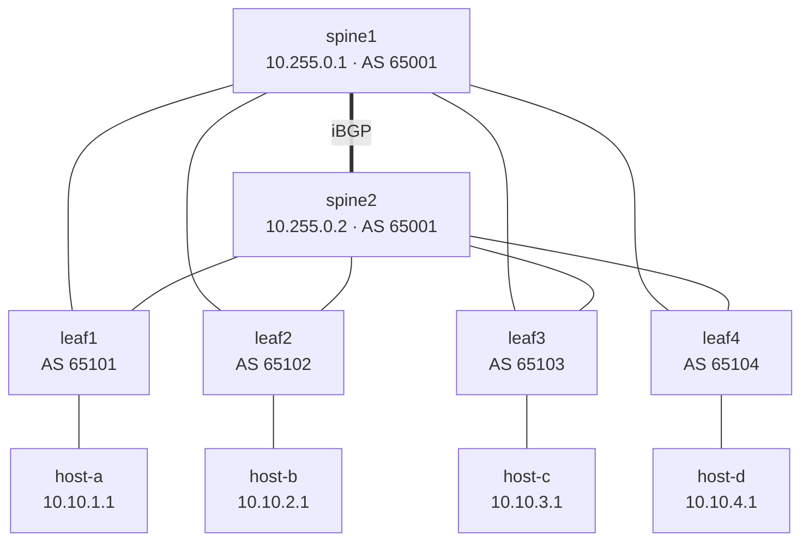

# Networking Lab

A declarative, version-controlled networking lab built with free and open-source tools. Containerlab runs FRR (FRRouting) containers in a spine-leaf topology with Alpine endpoint hosts, plus a small monitoring stack.

## Architecture



- **Underlay:** OSPF area 0 on /31 links (10.99.0.0/24) and loopbacks (10.255.0.0/24).
- **Overlay:** eBGP between each leaf and both spines, iBGP between the spines, all between loopbacks.
- **Failure detection:** BFD on every BGP session (900 ms).

More diagrams: [network topology](docs/diagrams/network-topology.md), [routing](docs/diagrams/routing.md), [automation and monitoring](docs/diagrams/automation-monitoring.md).

## Components

| Component | Tool | License |
|-----------|------|---------|
| Topology orchestration | Containerlab | BSD-3-Clause |
| Routers | FRRouting (FRR) 10.2.1 | GPL-2.0 |
| Endpoint hosts | Alpine Linux 3.20 | MIT |
| Automation | Ansible (`community.docker`) | GPL-3.0 |
| Metrics | frr_exporter + Prometheus + Grafana | MIT / Apache-2.0 / AGPL-3.0 |
| Observability (optional) | SuzieQ | Apache-2.0 |
| Config validation (optional) | Batfish | Apache-2.0 |
| DNS (optional) | dnsmasq | GPL-2.0 |

## Quick Start

```bash
git clone https://github.com/macrohard80/NetworkLab.git && cd NetworkLab
scripts/fetch-frr-exporter.sh      # optional: router metrics for Prometheus
scripts/deploy.sh                  # lab + Prometheus/Grafana

# Verify connectivity across the fabric
docker exec clab-netlab-host-a ping -c 3 10.10.3.1
docker exec clab-netlab-spine1 vtysh -c "show ip bgp summary"

# Re-push configs after editing configs/frr/* (no restart needed)
cd automation/ansible
ansible-galaxy collection install -r requirements.yml
ansible-playbook -i inventory.yml playbooks/deploy-configs.yml

# Tear down
scripts/deploy.sh destroy
```

Optional monitoring: `MON_PROFILES="batfish dns" scripts/deploy.sh`. See [monitoring/README.md](monitoring/README.md).

## Repository Structure

```
NetworkLab/
├── bin/                          # frr_exporter (downloaded, git-ignored)
├── configs/
│   ├── frr/{spine1,spine2,leaf1..4}/   # frr.conf, daemons, vtysh.conf
│   └── hosts/host-{a..d}.init.sh       # Alpine host addressing
├── automation/ansible/
│   ├── inventory.yml             # docker exec to clab-netlab-<node>
│   ├── requirements.yml          # community.docker
│   ├── group_vars/
│   └── playbooks/deploy-configs.yml
├── monitoring/                   # Prometheus + Grafana; optional SuzieQ, Batfish, dnsmasq
├── scripts/
│   ├── deploy.sh                 # deploy | destroy | status
│   └── fetch-frr-exporter.sh
├── docs/
│   ├── ip-addressing-plan.md
│   ├── cost-estimate.md
│   └── diagrams/
├── topology.clab.yml
└── CHANGELOG.md
```

See [docs/ip-addressing-plan.md](docs/ip-addressing-plan.md) for the full IP allocation and [docs/cost-estimate.md](docs/cost-estimate.md) for deployment costs.

## Requirements

- Linux host (Ubuntu 22.04+ / Debian 12 / Amazon Linux 2023)
- Docker Engine 24.0+ with the compose plugin
- Containerlab 0.55+
- Ansible core 2.14+ with `community.docker` (optional)
- 4+ vCPU, 16+ GB RAM, 50 GB disk

## License

MIT — see repository contents. All bundled tools retain their own licenses.
