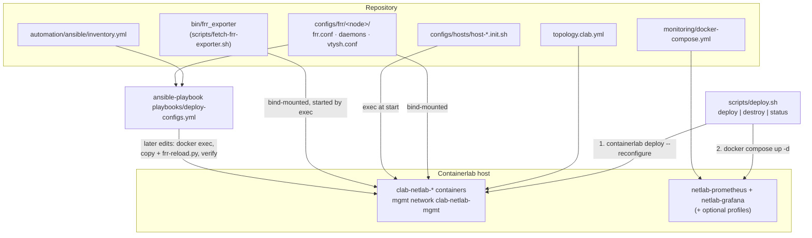
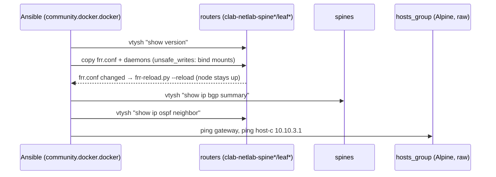
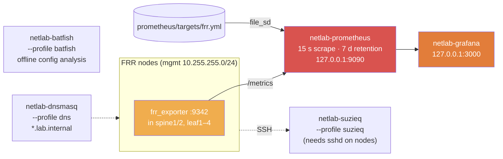

# Automation and Monitoring

## Deploy and Configure

## Ansible Plays

## Monitoring Data Flow

Only Prometheus and Grafana start by default. Ports bind to 127.0.0.1; from another machine use `ssh -L 3000:localhost:3000 -L 9090:localhost:9090 <lab-host>`.
