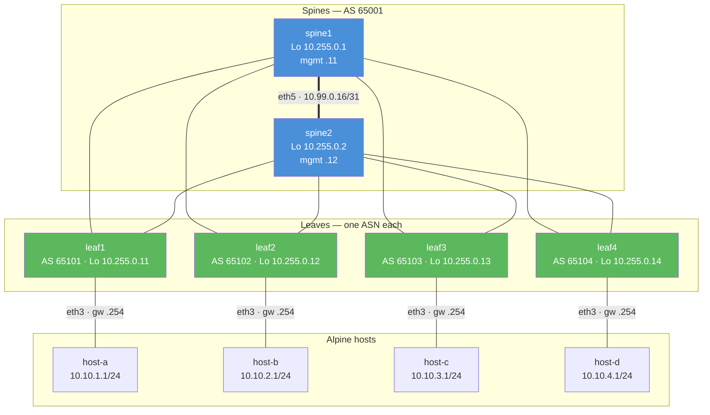
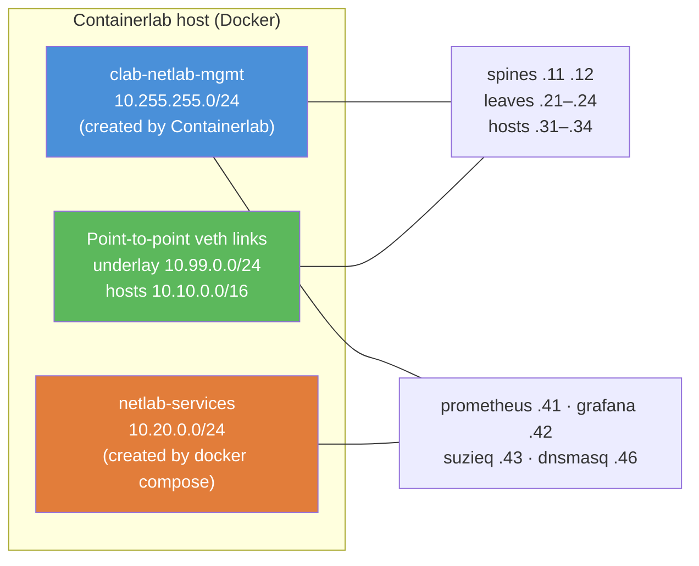

# Network Topology

One Containerlab lab (`topology.clab.yml`, lab name `netlab`): 2 spines, 4 leaves, 4 Alpine hosts. Containers are named `clab-netlab-<node>`.

## Spine-Leaf Fabric

## Underlay /31 Links — 10.99.0.0/24

| Link | Spine side | Leaf side |
|------|-----------|-----------|
| spine1 eth1 ↔ leaf1 eth1 | 10.99.0.0/31 | 10.99.0.1/31 |
| spine1 eth2 ↔ leaf2 eth1 | 10.99.0.2/31 | 10.99.0.3/31 |
| spine1 eth3 ↔ leaf3 eth1 | 10.99.0.4/31 | 10.99.0.5/31 |
| spine1 eth4 ↔ leaf4 eth1 | 10.99.0.6/31 | 10.99.0.7/31 |
| spine2 eth1 ↔ leaf1 eth2 | 10.99.0.8/31 | 10.99.0.9/31 |
| spine2 eth2 ↔ leaf2 eth2 | 10.99.0.10/31 | 10.99.0.11/31 |
| spine2 eth3 ↔ leaf3 eth2 | 10.99.0.12/31 | 10.99.0.13/31 |
| spine2 eth4 ↔ leaf4 eth2 | 10.99.0.14/31 | 10.99.0.15/31 |
| spine1 eth5 ↔ spine2 eth5 | 10.99.0.16/31 | 10.99.0.17/31 |

## Networks on the Host

