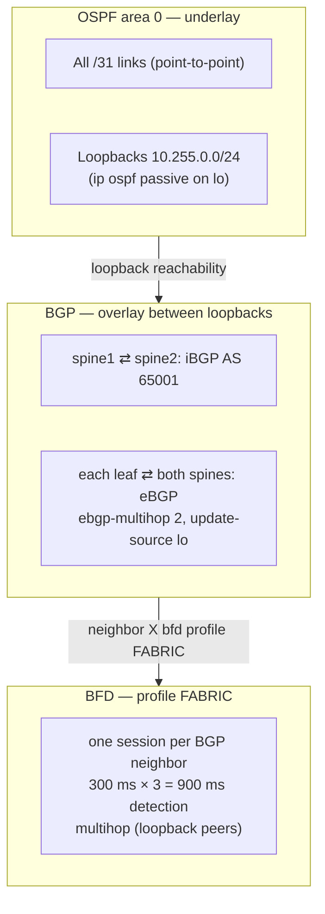
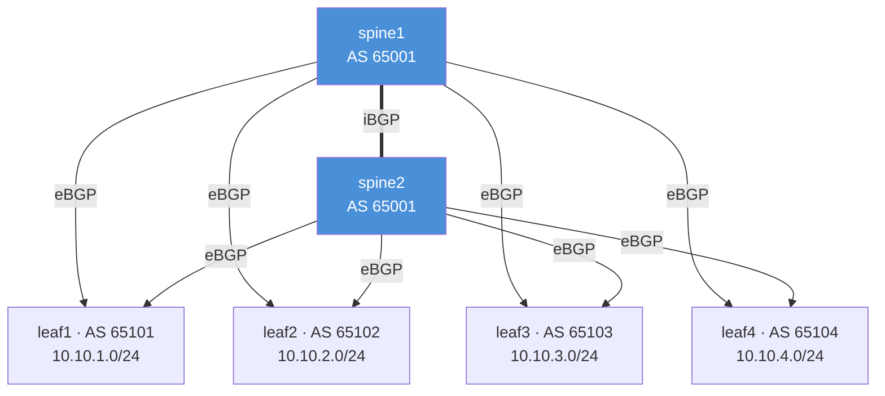
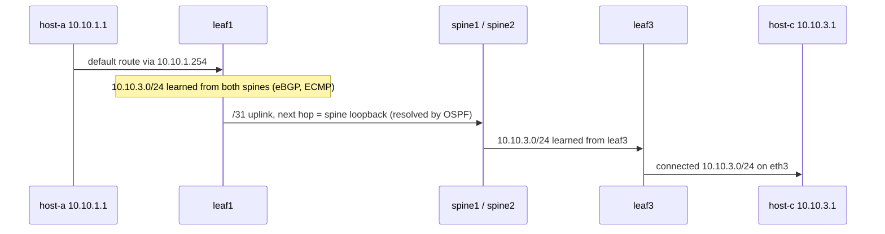

# Routing: OSPF Underlay, BGP Overlay, BFD

## Control Plane Layers

## BGP Peering

Spines peer with leaves over eBGP, which re-advertises routes by itself, so no route reflection is needed. Each leaf advertises its host /24 and its loopback; spines set `next-hop-self`.

## Packet Path: host-a → host-c

## Failure Handling

| Failure | Detection | Result |
|---------|-----------|--------|
| One spine | BFD ~900 ms on every leaf | Leaves use the remaining spine |
| One spine-leaf link | OSPF + BFD | Traffic to that leaf goes via the other spine |
| One leaf | BFD on both spines | Its host /24 is withdrawn (hosts are single-homed) |
